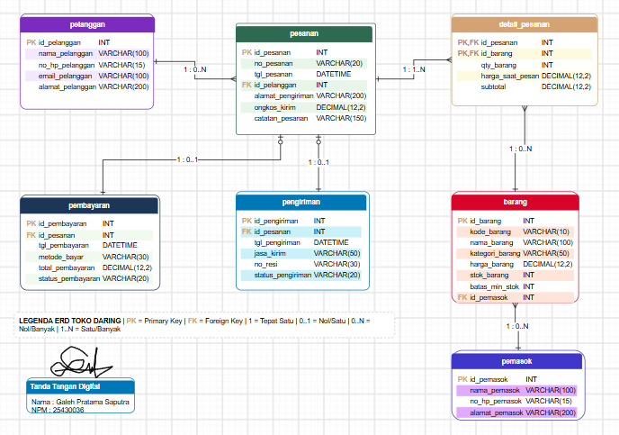

## F. Tugas Mandiri: Milestone Proyek 4

Normalisasi dan skema relasional toko daring

1. Dokumen sumber dan bentuk UNF

Dokumen sumber yang di gunakan adalah nota pesanan toko daring. Dokumen ini berisi informasi pelanggan,pesanan,barang yang dibeli,pembayaran dan pengiriman.

1. bentuk UNF:

```
NOTA_UNF (
    no_pesanan,
    tanggal_pesanan,
    id_pelanggan,
    nama_pelanggan,
    no_hp_pelanggan,
    alamat_pengiriman,
    {
        id_barang,
        nama_barang,
        kategori_barang,
        harga_saat_pesan,
        qty_barang,
        subtotal
    },
    ongkos_kirim,
    metode_bayar,
    status_pembayaran,
    jasa_kirim,
    no_resi,
    status_pengiriman,
    total_pembayaran
)
```

Pada bentuk UNF,satu pesanan bisa memiliki kelompok data barang yang berulang karena satu pesanan bisa berisi beberapa barang.

2. Dependensi fungsional dan  Kode AB

Dependensi fungsional adalah hubungan antara satu data dengan data lainnya.

* `id_pelanggan → nama_pelanggan, no_hp_pelanggan, email` (AB-10), karena setiap pelanggan memiliki ID unik.
* `id_barang → nama_barang, harga_barang, stok_barang`karena setiap barang memiliki data sendiri.
* `no_pesanan → tanggal_pesanan, id_pelanggan, alamat_pengiriman, ongkos_kirim` (AB-01, AB-05, AB-06).
* `(no_pesanan, id_barang) → qty_barang, harga_saat_pesan` (AB-02, AB-04).
* `id_pembayaran → tanggal_pembayaran, metode_bayar, status_pembayaran`berdasarkan kebutuhan pencatatan pembayaran.
* `id_pengiriman → jasa_kirim, no_resi, status_pengiriman` (AB-07, AB-08).

3. Tahapan normalisasi

a. Bentuk 1NF

```
NOTA_1NF (
    no_pesanan,
    id_barang,
    tanggal_pesanan,
    id_pelanggan,
    nama_pelanggan,
    nama_barang,
    harga_saat_pesan,
    qty_barang,
    ongkos_kirim
)

Primary Key: (no_pesanan, id_barang)
```

Pada 1NF,data barangnya yang berulang dipisahkan.Satu baris hanya berisi satu jenis barang dalam satu pesanan.

b. Bentuk 2NF

```
PELANGGAN (
    id_pelanggan,
    nama_pelanggan,
    no_hp_pelanggan,
    email
)

BARANG (
    id_barang,
    nama_barang,
    harga_barang,
    stok_barang
)

PESANAN (
    no_pesanan,
    tanggal_pesanan,
    id_pelanggan,
    alamat_pengiriman,
    ongkos_kirim
)

DETAIL_PESANAN (
    no_pesanan,
    id_barang,
    qty_barang,
    harga_saat_pesan
)
```

Pada 2NF,data pelanggan dan barang dipisahkan supaya tidak perlu ditulis berulang kali.

c. Bentuk 3NF

```
PELANGGAN (
    id_pelanggan PK,
    nama_pelanggan,
    no_hp_pelanggan,
    email
)

PEMASOK (
    id_pemasok PK,
    nama_pemasok,
    no_hp_pemasok,
    alamat_pemasok
)

BARANG (
    id_barang PK,
    nama_barang,
    harga_barang,
    stok_barang,
    id_pemasok FK
)

PESANAN (
    no_pesanan PK,
    tanggal_pesanan,
    id_pelanggan FK,
    alamat_pengiriman,
    ongkos_kirim
)

DETAIL_PESANAN (
    no_pesanan PK/FK,
    id_barang PK/FK,
    qty_barang,
    harga_saat_pesan
)

PEMBAYARAN (
    id_pembayaran PK,
    no_pesanan FK,
    tanggal_pembayaran,
    metode_bayar,
    status_pembayaran
)

PENGIRIMAN (
    id_pengiriman PK,
    no_pesanan FK,
    jasa_kirim,
    no_resi,
    status_pengiriman
)
```

pada 3NF, data sudah dipisahkan sesuai bagiannya.Dengan begitu, data lebih rapi dan perubahan pada satu tabel tidak perlu dilakukan berulang kali ditabel lain.

d. Pemeriksaan BCNF

| Tabel          | Determinan utama          | Hasil pemeriksaan                                  |
| -------------- | ------------------------- | -------------------------------------------------- |
| PELANGGAN      | `id_pelanggan`          | Memenuhi jika ID menentukan seluruh atribut        |
| PEMASOK        | `id_pemasok`            | Memenuhi jika ID menentukan seluruh atribut        |
| BARANG         | `id_barang`             | Memenuhi jika ID menentukan seluruh atribut        |
| PESANAN        | `no_pesanan`            | Memenuhi jika nomor menentukan seluruh atribut     |
| DETAIL_PESANAN | `no_pesanan, id_barang` | Memenuhi jika kombinasi menentukan seluruh atribut |
| PEMBAYARAN     | `id_pembayaran`         | Memenuhi jika ID menentukan seluruh atribut        |
| PENGIRIMAN     | `id_pengiriman`         | Memenuhi jika ID menentukan seluruh atribut        |

BCNF diperiksa dengan melihat apakah setiap penentu merupakan superkey.Berdasarkan rancangan ini,tabel dibuat menggunakan kunci utama yang menentukan data lainnya.Pemeriksaan akhir tetap perlu di sesuaikan dengan semua dependensi fungsional yang berlaku.

4. Nilai yang disimpan dan dihitung

* **Subtotal:** dihitung dari jumlah barang dikali harga saat pemesanan.
* **Total pembayaran:** dihitung dari seluruh subtotal ditambah ongkos kirim.
* **Harga saat pemesanan:** disimpan supaya harga transaksi lama tidak ikut berubah.
* **Ongkos kirim:** disimpan karena biaya setiap pesanan bisa berbeda.
* **Alamat pengiriman:** disimpan supaya alamat saat transaksi tetap tercatat.
* **Stok barang:** disimpan dan diperbarui setiap ada barang terjual.
* **Laporan penjualan bulanan:** dihitung dari data transaksi yang tersimpan.

5. Perubahan ERD

Setelah normalisasi,beberapa perubahan dilakukan:

1. Data pelanggan dipisahkan dari pesanan.
2. Data barang dipisahkan dari detail pesanan.
3. Tabel Detail Pesanan digunakan untuk mencatat barang yang dibeli.
4. Data pembayaran dan pengiriman dibuat dalam tabel tersendiri.
5. Data pemasok dihubungkan dengan barang melalui `id_pemasok`.

